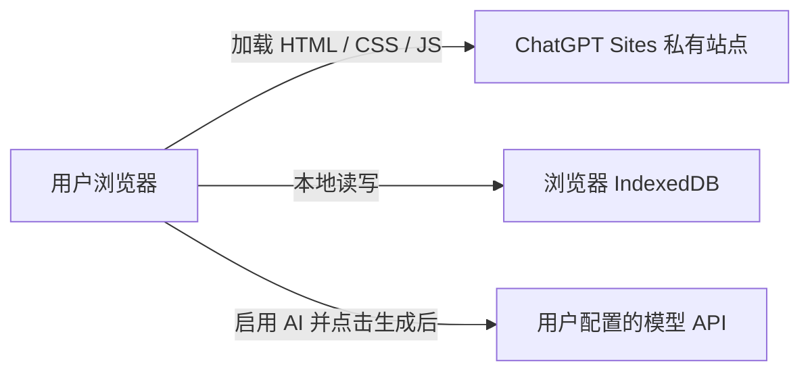
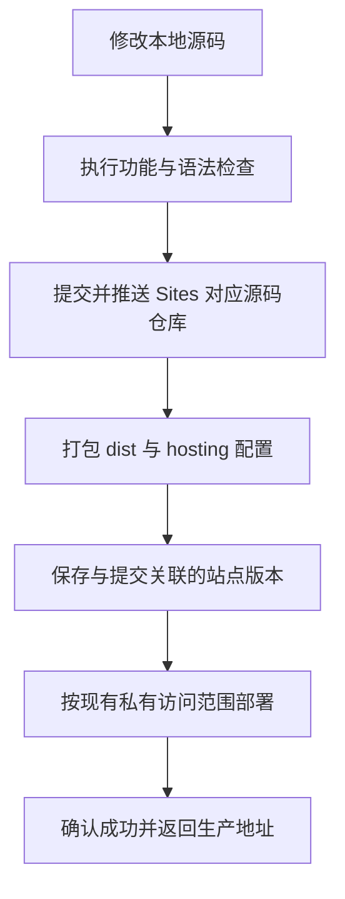

# SpecFlow 当前部署说明

## 1. 部署在哪里

当前站点由 **ChatGPT Sites 托管平台**管理，生产访问地址：

https://specflow-tech-studio-1021.loyal-snail-7652.chatgpt.site

核对站点配置时，访问模式为 `custom`，显式访问名单只有当前所有者一人，没有用户组；本次更新沿用这个私有访问范围。平台管理员仍可能具有平台规则允许的管理权限。私有站点是受限访问的线上部署，不是 localhost 预览。

这是 Sites 平台管理的托管项目。当前站点信息没有返回底层云资源、物理机房或具体地域，不能仅根据域名判断部署在某个国内或海外机房。

可以在 ChatGPT 的 Sites 列表中查看、管理和调整站点。站点管理文档：

- https://learn.chatgpt.com/docs/sites/managing-a-site
- https://learn.chatgpt.com/docs/sites/publishing-and-sharing

## 2. 当前系统运行结构



| 内容 | 实际位置与处理方式 |
| --- | --- |
| 网页、解析组件和图表组件 | 从 Sites 托管的 `dist/` 静态资源加载 |
| 需求文档和项目源码 | 用户选择文件后，在浏览器中读取和解析 |
| 项目、解析文本、方案、模板和历史 | 当前站点域名下的浏览器 IndexedDB |
| 结构化草稿 | 浏览器执行 `dist/core.js` 中的规则生成器 |
| AI 方案 | 浏览器直接请求用户配置的 Chat Completions 接口 |
| 模型 API Key | 仅当前页面内存；不写入 IndexedDB，也不随站点源码发布 |
| 技术文档中的图表 | 浏览器本地运行 Mermaid；Markdown 导出保留图表源码 |

目前没有业务 API 服务、云端业务数据库或后端任务队列。因此同一个站点在不同设备、浏览器或域名下，看到的是各自独立的项目数据；共享站点访问权限也不会自动共享浏览器中的项目。

## 3. 关键文件分别做什么

| 文件 | 作用 |
| --- | --- |
| `.openai/hosting.json` | 绑定既有 Sites 项目，声明部署静态目录 `dist` |
| `dist/index.html` | 页面入口，加载运行依赖和应用脚本 |
| `dist/core.js` | 模块提取、草稿生成与 AI 提示词构建 |
| `dist/app.js` | 交互、文件导入、存储与模型请求 |
| `dist/diagrams.js` | 将 Markdown 中的 Mermaid 围栏转为图表 |
| `dist/assets/` | 已打包的 Word/PDF/ZIP、Markdown 与图表运行组件及许可证 |
| `server.cjs` | 本地静态预览服务器，默认只监听 `127.0.0.1:5178` |
| `scripts/publish-source.cjs` | 使用临时凭据提交、推送并核对专用源码仓库的提交 |
| `scripts/package-static.py` | 将已验证的静态目录与 hosting 配置打为发布归档 |
| `tests/run.cjs` | 功能集成检查；图表使用真实 Mermaid 语法解析，SVG 布局绘制通过接口替身验证接入 |

`server.cjs` 没有被当作常驻 Node 后端部署到线上。关闭本地服务器或电脑不会关闭已经部署的 Sites 站点。

## 4. 本次采用的部署流程



### 第一步：修改与本地预览

当前项目是直接运行的 HTML、CSS、JavaScript，不需要 Vite、Webpack 或服务端编译。`dist/` 既是可维护的应用文件目录，也是最终部署目录，因此它需要进入版本管理。

在项目目录执行：

```sh
node server.cjs
```

然后打开 http://localhost:5178 。这个服务只负责本地预览，与 Sites 的线上运行互相独立。

### 第二步：检查修改

使用 Node.js 22 及以上运行开发检查：

```sh
npm install
npm test
```

验证文档解析、多类型方案、自定义目录、历史恢复、模型调用的请求与错误处理、图表语法及导出。JSDOM 不具备真实浏览器的 SVG 布局能力，所以图表测试使用真实 Mermaid 解析器检查语法，再通过渲染接口替身检查页面接入和 SVG 清洗；这不等同于完成真实浏览器视觉验收。

### 第三步：复用已存在的站点

从 `.openai/hosting.json` 读取 `project_id`，复用已经创建的 Sites 项目，不为每次修改新建站点。当前配置：

```json
{
  "project_id": "appgprj_6ad82442f508819186fc5589841c5397",
  "static": { "directory": "dist" }
}
```

这个 ID 是项目标识，不是 API Key；配置中没有发布凭据或模型密钥。

### 第四步：同步精确源码版本

通过 Sites 连接工具取得这个项目的短期源码写入凭据。`publish-source.cjs` 从隐藏标准输入接收凭据，并通过子进程环境传递单次 Git HTTP 授权，不写入 remote URL、源码文件或 Git 持久配置。

脚本在当前项目独立 Git 仓库中提交修改，推送到凭据指定的专用源码仓库与分支，然后用远端分支头核对提交 SHA。它不会推送整个上层 `practice` 仓库，也不会把源码发布为公开 GitHub 仓库。

`.gitignore` 中的 `node_modules/`、`.sites-runtime/`、发布归档、日志与 `.env` 不进入这个源码提交。本次没有配置仓库自动发布钩子；只保存文件、`git commit` 或普通推送都不会自动更新站点。

### 第五步：打包同一版本的静态资源

执行：

```sh
python scripts/package-static.py
```

生成 `site.tar.gz`，归档包含：

```text
.openai/hosting.json
dist/
  index.html
  styles.css
  core.js
  app.js
  diagrams.js
  assets/
```

归档只放部署资源和 hosting 配置，不包含测试依赖、独立 Node 运行时或用户在浏览器导入的项目资料。必须保持打包资源与刚推送的提交一致。

### 第六步：保存版本并私有部署

使用 Sites 的 `save_version_and_deploy_private`，传入项目 ID、已推送提交 SHA 和静态归档路径。该操作将源码版本与部署资源关联，保存站点版本并发布；它不是本地 shell 中的 npm 命令，需要当前账号连接的 Sites 工具及相应权限。

如果创建了未完成的部署，就继续查询同一次部署状态；只有返回 `succeeded` 才认定发布成功。访问范围保持已有的所有者私有配置。

### 第七步：确认线上版本

发布成功后继续使用原有生产 URL。刷新页面加载新代码；已经保存的历史文档仍是原文本，需要重新点击生成才能使用新版图文模板。

如果需要回退，应列出并选择已经保存的历史版本，再部署该版本。它会切换网页代码版本；浏览器中的项目资料和 AI 服务商侧的数据不会随网页代码版本一起回滚。

## 5. 后续部署到自有环境

当前静态页面可由支持 HTTPS 的静态托管或 Nginx 托管 `dist/`；模型接口仍需支持浏览器 CORS。换域名后，本地 IndexedDB 与原域名隔离。

如果升级为团队系统，应另外实现用户身份、业务后端、服务端模型代理、云端文档与源码存储，以及后台生成任务。当前发布的是可工作的个人工作台首版；这些服务端能力尚未部署。